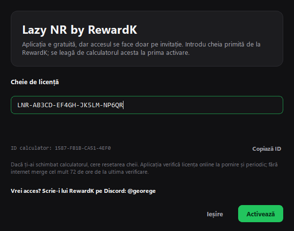
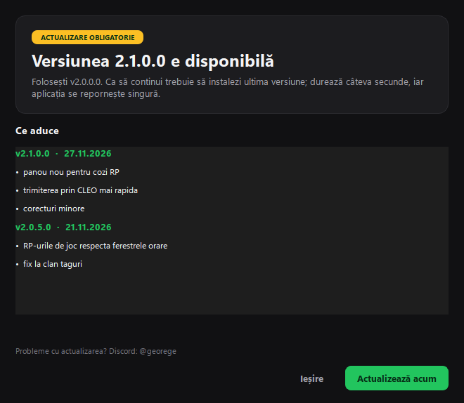
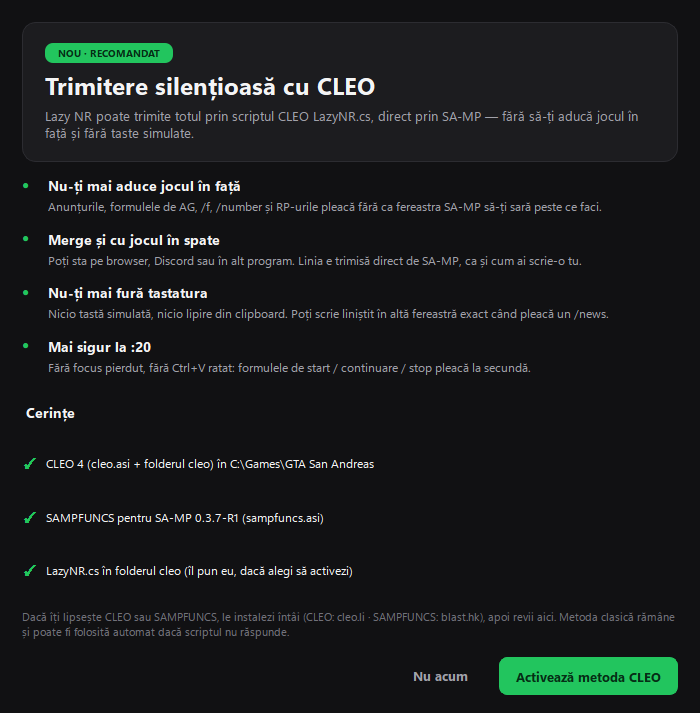
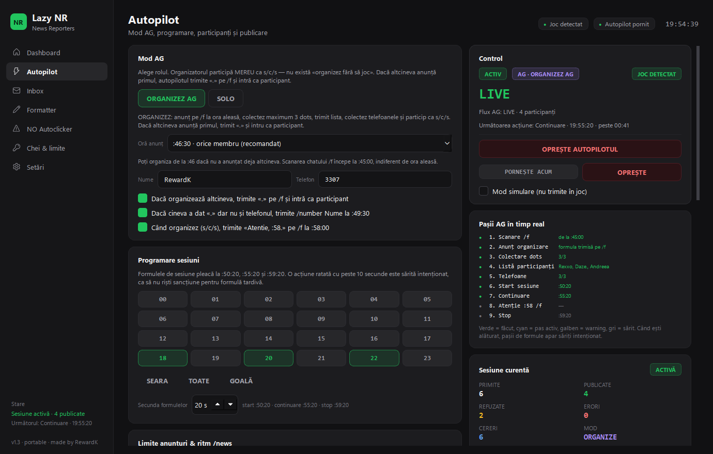
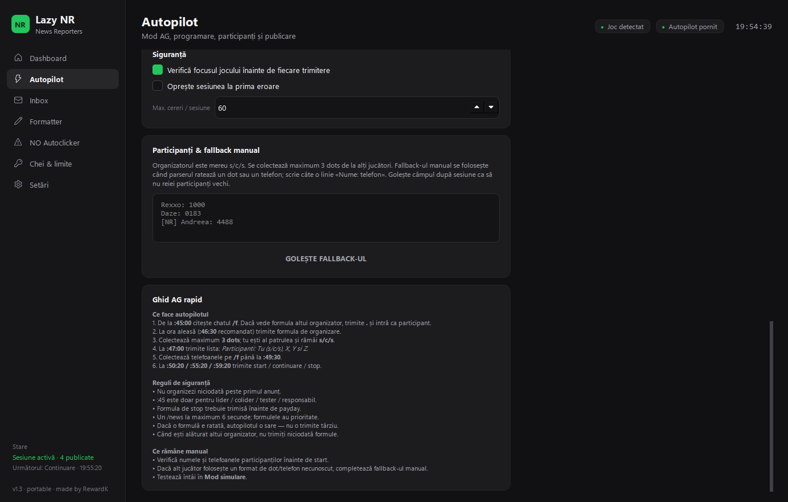
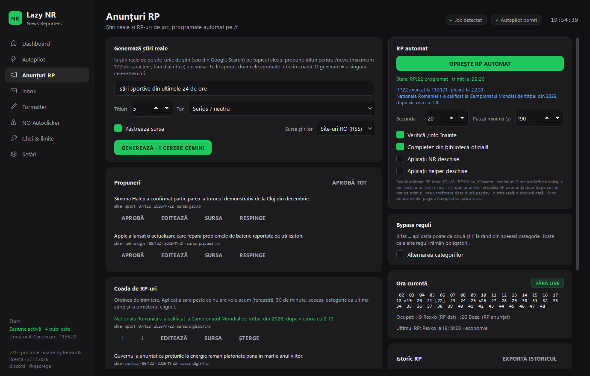
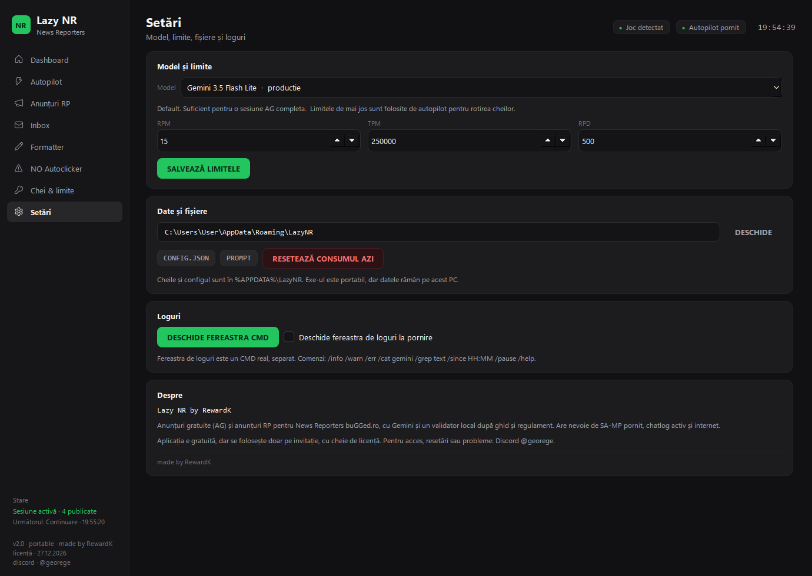

## **v2.0 LATEST UPDATE**

* **adaugat sistem de licente. nu mai este&#x20;**_**free use.**_ este gratuita in continuare. daca doresti acces, scrie-mi pe discord la **@georege**. e mai mult pentru protectie la admini;
* **adaugat auto update;&#x20;**&#x75;pdate-urile sunt obligatorii, si se fac automat, dar cu acordul tau;

### **ADAUGAT SILENT PASTE MODE**

ce face? inainte, cand avea de trimis un mesaj, iti dadea focus la joc, dadea paste, si enter. **am adaugat o metoda mult mai clean.** **acum aplicatia trimite comenzi in joc folosind un script .cs (CLEO).&#x20;**&#x70;ractic, aplicatia doar spune acelui cleo ce sa trimita, iar acesta trimite in joc.

**CARE SUNT AVANTAJELE?&#x20;**&#x61;plicatia ruleaza full in background. poti sa o ai mereu in bara, sa faci orice alt ceva, nu te mai intrerupe daca faci alt ceva.
**DE UNDE IAU ACEST CLEO?** cand intri in aplicatie, te intreaba daca vrei sa folosesti metoda asta si te pune sa selectezi unde e folderul jocului **(necesar sa ai CLEO 4 si SAMPFUNCS pt a folosi acest feature.** le poti descarca de pe moduri.ro), iar apoi iti insereaza automat acel .cs.

## lazy nr

app de windows facuta pt factiunea news reporters de pe bugged.ro (samp). se ocupa de partea plictisitoare: organizeaza ag-ul, citeste sms-urile, le face anunturi dupa ghid si le da pe /news. da si rp-uri si poate trimite totul silentios prin cleo. de la 2.0 merge doar cu cheie de licenta.

citeste chatlog.txt din joc, foloseste gemini ca sa scrie anunturile si le trimite in joc ca si cum ai scrie tu (aduce fereastra samp in fata, lipeste, enter). fiecare anunt trece printr-un validator local scris dupa ghidul reporterului si regulamentul intern inainte sa plece.

versiune 2.0.0.0, un singur exe, fara instalare, win 10/11.

app-ul e gratis. nu costa nimic si nu vand nimic. dar il dau doar celor carora vreau eu sa-l dau: porneste doar cu cheie de licenta. vrei acces? scrie-mi pe discord: @georege

## download

iei `Lazy NR by RewardK.exe` din [releases](../../releases/latest) si il pornesti.

* marime: 53.924.552 bytes
* sha256: f36506163bec8ca819d1208775cb31f7a1c8e0bf9ea74b8e4984c384659ffa85

exe-ul nu e semnat, deci smartscreen o sa se planga prima data (more info -> run anyway). daca vrei sa fii sigur verifici hash-ul si il bagi pe [virustotal](https://www.virustotal.com/gui/home/upload).

## ce iti trebuie

* o cheie de licenta (vezi mai jos)
* samp pornit cu chatlog activ (Documents\GTA San Andreas User Files\SAMP\chatlog.txt, daca nu e scrii /chatlog in joc)
* o cheie gemini de-a ta (e gratis, vezi la chei & limite)
* net
* daca rulezi samp ca admin, porneste si app-ul ca admin, altfel windows nu-l lasa sa scrie in joc

## licenta

de la 2.0 app-ul porneste doar cu o cheie de licenta, de forma LNR-XXXXX-XXXXX-XXXXX-XXXXX. cheia e gratis, dar o primesti doar de la mine, pe discord: @georege. fara cheie nu merge, si nu o poti obtine altfel.

* la prima pornire bagi cheia si dai activeaza. cheia se leaga de calculatorul tau
* apoi n-o mai bagi, app-ul o tine minte si o verifica singur la pornire si o data la 20 de minute
* fara net merge cel mult 72 de ore de la ultima verificare, dupa aia trebuie net
* daca iti schimbi calculatorul (sau windows-ul), ceri resetarea cheii pe discord (@georege). id-ul calculatorului e jos in fereastra de licenta
* jos in stanga, sub versiune, vezi pana cand e valabila cheia (si contactul de discord)
* daca cheia e dezactivata sau expira, app-ul se opreste si iti cere alta cheie. se poate retrage oricand

prompturile de la gemini nu mai sunt in exe, vin de la server doar cu o cheie valida.

## actualizari

actualizarea e obligatorie: tot timpul trebuie sa rulezi ultima versiune.

* la pornire (si apoi o data la 20 de minute) app-ul afla daca exista o versiune noua
* daca exista, apare fereastra de mai sus cu ce aduce fiecare versiune pe care ai sarit-o. pana nu actualizezi nu poti folosi app-ul, doar sa iesi
* dai actualizeaza acum: descarca exe-ul, verifica hash-ul, se inlocuieste singur si se reporneste. nu mai tre sa descarci nimic de mana
* descarcarea merge doar cu cheie valida
* exe-ul vechi ramane o clipa ca "Lazy NR by RewardK.exe.old" si se sterge singur la urmatoarea pornire
* daca nu poate inlocui exe-ul (il ai intr-un folder fara drepturi) iti zice, si il muti intr-un folder normal

## trimitere silentioasa (cleo)

metoda noua si recomandata. in loc sa aduca jocul in fata si sa apese taste, app-ul trimite tot prin scriptul cleo LazyNR.cs, direct prin sa-mp.

* nu-ti mai aduce jocul peste ce faci
* merge si cu jocul in spate (browser, discord, alt program)
* nu-ti mai fura tastatura, poti scrie linistit in alta fereastra cand pleaca un /news
* formulele de la :20 pleaca la secunda, fara focus pierdut sau ctrl+v ratat
* merge pt tot: /news, /f, /id, /number, /info, raspunsul la somatii

ce iti trebuie: cleo 4 + sampfuncs (pt sa-mp 0.3.7-R1).

cum se pune:

* cand deschizi app-ul prima data iti apare fereastra de mai sus, cu ce ai si ce iti lipseste
* dai activeaza metoda cleo, alegi folderul jocului (unde e gta_sa.exe) si app-ul verifica cleo + sampfuncs si pune singur LazyNR.cs in folderul cleo
* daca jocul era deschis, iesi si intra din nou (scripturile cleo se incarca la pornire). in joc trebuie sa apara "LazyNR by RewardK (bugged.ro) a fost incarcat"
* in joc: /lazynr arata cate linii a trimis si ultima linie, /lazynrtog il opreste / porneste
* daca zici nu acum, pe dashboard ramane un banner rosu cu info si treci pe cleo

cum merge: app-ul scrie linia in cleo\lazynr_send.txt, scriptul o citeste la 50ms, sterge fisierul si o trimite cu samp say_msg. daca scriptul nu raspunde in 2-3 secunde (joc pornit inainte sa pui scriptul, /lazynrtog oprit), linia pleaca prin metoda clasica si app-ul mai incearca cleo dupa un minut. bifa asta se poate scoate din autopilot -> publicare.

sursa scriptului e in app (assets\cleo\LazyNR.txt), daca vrei sa-l compilezi tu cu sanny builder.

## primii pasi

1. bagi cheia de licenta
2. pui o cheie gemini in chei & limite
3. in autopilot pui numele exact din joc, nr tau de telefon si orele cu ag
4. bifezi mod simulare si il lasi o ora sa vezi ce face fara sa trimita nimic in joc
5. cand e ok, scoti simularea si dai porneste autopilotul

## dashboard

pagina de start, vezi rapid ce se intampla.

* daca e pornit autopilotul si daca vede jocul
* banner rosu sus cat timp nu folosesti trimiterea prin cleo, cu info si treci pe cleo
* sesiunea de ag curenta: cate sms-uri, cate anunturi publicate, cate refuzate
* la ce pas e ag-ul (scanare, dots, lista, telefoane, start etc)
* cate cereri gemini ai facut azi si cat a mancat fiecare cheie
* ultimele evenimente din log
* scurtaturi: porneste autopilotul, simulare, formateaza un sms, loguri

## autopilot

aici e tot ag-ul. setezi o data si merge singur la orele alese.

rolul tau la ag:

* organizez ag: anunta ag-ul pe /f daca nu l-a anuntat altcineva, strange max 3 puncte, da lista si formulele. tu esti mereu s/c/s
* solo: nu organizeaza nimic, porneste sesiunea doar cu nr tau
* alaturat (automat): daca a anuntat altcineva primul, pune "." pe /f si nu da formule peste organizator
* ma ofer s/c/s (optional): cand te alaturi scrie si "Ma ofer s/c/s.". daca organizatorul te pune s/c/s (in orice forma: "Participanti: Tu (s/c/s), ...", "reward s/c/s, x ajuta", "s/c/s: Tu") dai tu formulele, daca nu ramai participant

cum merge o ora:

* :45:00 incepe sa citeasca /f
* :46:30 (se poate schimba) anunta ag-ul. :45 si :45:30 sunt doar pt lider/colider/tester/responsabil, te avertizeaza
* :47:00 da lista "Participanti: Tu (s/c/s), X, Y si Z."
* imediat dupa lista da /id pe numele fiecarui participant (cauta si dupa o bucata din nume, deci merge si daca pe /f apare fara tag-ul de clan, gen PLETOSU\@DRUJBARU vs \[TOMAN]PlETOSU\@DRUJBARU), ia id-ul din paranteze si da /number id. numerele se iau din raspunsul serverului, nu din ce scriu oamenii pe /f
* daca /id gaseste mai multi jucatori il ia doar pe cel cu numele identic, sau pe singurul care seamana. daca sunt mai multi si niciunul identic nu ghiceste, iti zice in log sa-l adaugi de mana
* la :49:30, pt cine tot n-are numar, mai incearca o data cu /number pe nume
* :50:20 / :55:20 / :59:20 start, continuare, stop cu formulele oficiale. secunda se poate schimba, am pus :20 ca ceasul serverului e putin in urma
* :58:00 "Atentie, :58." pe /f (doar ca s/c/s)
* daca o formula ar pleca cu peste 10s intarziere o sare. mai bine lipsa decat data tarziu

numere la ag-ul curent:

* vezi exact ce numere intra in formula si de unde e fiecare (tu, /number, adaugat manual)
* poti adauga un nr de mana (nume + telefon). daca jucatorul e deja in lista, nr tau il inlocuieste
* sterge = il scoate din ag
* un nr venit dupa start intra la continuare si stop
* lista se goleste singura cand se termina ag-ul

anunturile din sesiune:

* fiecare sms trece prin gemini si apoi prin validator: structura din ghid, numele si nr expeditorului, fiecare numar (pret, zile, km, id) trebuie sa fie in sms
* repara singur greselile mecanice: vand -> vinde, mai multe tickete pe vehicul -> "cu tickete", "si" intre ultimele detalii, "la pretul de" / "avand un buget de"
* regula de 5 min: daca jucatorul a primit anunt de curand, sms-ul nou asteapta si pleaca singur cand se poate
* refuza ce n-are voie pe /news (materiale, vand + cumpar in acelasi sms etc)
* hotring racer (orice varianta) nu se mai da deloc, sms-ul e refuzat direct fara sa mai intrebe gemini
* regula de 5 min si dublurile le verifica app-ul cu ora exacta, gemini nu mai primeste istoricul (inainte refuza uneori aiurea un sms venit la fix 5 min)

limite si publicare:

* min / max anunturi pe sesiune (minimul automat e cel din regulament: 5 ziua, 3 noaptea)
* un /news la max 6s (se poate schimba)
* max cereri gemini pe sesiune si "opreste la prima eroare"
* full auto (lipeste si da enter singur) sau clipboard (copiaza si lipesti tu)
* trimitere silentioasa prin cleo: activeaza, testeaza (/lazynr), dezactiveaza, si daca sa treaca pe metoda clasica cand scriptul nu raspunde
* mod simulare: face tot dar nu trimite nimic in joc
* zona de test: bagi un sms sau o linie de /f de mana si vezi ce face

## anunturi rp

da rp-uri pe /news programate corect pe /f, dupa sectiunea 1 din regulament si topicul cu anunturi rp.

stiri reale:

* scrii un topic, gen "stiri sportive din ultimele 24 de ore", cate titluri vrei si tonul (serios, entuziast, optimist, critic, dramatic, batjocoritor)
* sursa stirilor: by default ia titlurile direct din rss-ul site-urilor (digi24, hotnews, stirileprotv, mediafax, g4media, libertatea, gsp, digisport, prosport, profit, zf, playtech), dupa topic. gemini doar alege si reformuleaza, deci stirile sunt reale si linkul e al articolului. se poate trece si pe google search, dar aia are cota separata si de obicei nu merge pe planul gratis
* genereaza = o singura cerere gemini, primesti propuneri cu sursa
* butonul sursa copiaza linkul, bun daca te intreaba cineva de unde e stirea
* tu aprobi ce intra in coada. stirile cu violenta (regula 20) si cele pe ton batjocoritor (regula 13, se sanctioneaza) iti cer confirmare separat

coada:

* adaugi, stergi, editezi, muti ordinea
* poti scrie rp-uri de-ale tale sau iei din biblioteca oficiala (\~75 rp-uri din topic). fiecare se da doar cand are voie: seara, noaptea, la war, cu aplicatiile deschise, de craciun, de anul nou
* sare peste ce n-are voie acum: aceeasi stire a doua oara, acelasi rp in 30 min, doua stiri la rand din aceeasi categorie, rp identic cu al colegului de dinainte, recrutare mai des de 30 min
* daca n-are ce da poate lua singur un rp din biblioteca (bifa)
* bypass la alternarea categoriilor (bifa): daca vrei poate da doua stiri la rand din aceeasi categorie. restul regulilor raman obligatorii

programarea:

* cand il pornesti citeste ora curenta din chatlog (rp-uri anuntate sau date de colegi, live-uri), deci stie si de ce s-a programat inainte sa-l deschizi. nu ia nimic din ora trecuta, iar stirile automate de la AdmBot nu conteaza
* da /info si verifica sa nu fie nimeni in live
* alege primul minut liber intre :02 si :48, la min 2 minute de rp-urile colegilor si la min 190s dupa rp-ul tau dinainte
* scrie pe /f RP:XX si da rp-ul in minutul XX la secunda aleasa (default :20)
* imediat dupa anunta urmatorul. niciodata doua programate deodata
* daca cineva anunta live (Live 21:09, Live :02, Emisiune: 05) sau intra cineva in live, isi anuleaza rp-ul ("RP:XX anulat.") si reia la 2 min dupa ce se termina
* pt ora urmatoare programeaza doar dupa payday

istoric:

* fiecare rp dat se salveaza cu ora si sursa, se poate exporta
* contor pt bonusul news hunter (10 stiri reale pe saptamana)

## inbox

toate sms-urile prelucrate si ce s-a intamplat cu fiecare.

* textul primit, anuntul scris si statusul (publicat, refuzat, in asteptare, eroare)
* motivul refuzului cand e cazul
* ce cheie s-a folosit si cat a durat
* filtru pe status
* copiaza anuntul si am lipit (pt modul clipboard)
* goleste

## formatter

cand vrei doar sa vezi cum ar arata un anunt, fara sa publici.

* lipesti linia intreaga (SMS from Nume (1234): text) sau pui separat nume, telefon, text
* formateaza il trece prin gemini si prin acelasi validator ca la ag
* vezi anuntul, decizia (publica / refuza), motivul si erorile
* ora si sesiunea nu conteaza aici, dar structura e verificata la fel de strict
* copiaza

## no autoclicker

cand te intreaba un admin/helper daca esti la pc, app-ul vede si raspunde in locul tau.

* citeste toate chat-urile (whisper, pm, sms, admin, public) si da un scor fiecarei linii: e pt tine, intreaba de pc/afk/autoclick, ameninta cu sanctiune, e de la cineva din lista ta de staff
* peste prag: banner rosu, sunet, notificare windows si anunturile noi asteapta pana confirmi
* raspunde singur pe chatul public cu ceva scurt ("da ma normal ca sunt"), scris de gemini sau fix
* ai \~2s sa-l anulezi. butoane: trimite acum, regenereaza, anuleaza, am raspuns eu
* daca raspunsul nu pleaca in 2 min da /q, sa nu ramai cu autoclickerul pornit
* max 5 raspunsuri pe ora, fara dubluri la aceeasi somatie
* lista ta de staff, cuvinte cheie proprii si testeaza alerta

## chei & limite

* adaugi chei gemini, fiecare cu o eticheta (principal, rezerva etc)
* testeaza / testeaza toate
* bifa activa ca sa scoti o cheie temporar fara s-o stergi
* vezi consumul pe fiecare cheie si ultimele erori
* cu mai multe chei le roteste singur. la 429 (limita) pune cheia pe pauza si trece la urmatoarea

cum iti faci o cheie:

1. intri pe [aistudio.google.com/app/apikey](https://aistudio.google.com/app/apikey) cu contul google
2. create api key, alegi sau faci un proiect
3. copiezi cheia (incepe cu AQ. sau AIza) si o lipesti in app

cheile stau in text simplu in %APPDATA%\LazyNR\config.json, nu da fisierul ala la nimeni.

## setari

* modelul gemini si limitele lui (cereri/min, tokeni/min, cereri/zi)
* folderul cu date si config.json (daca pui acolo un prompt-gemini-ag.md al tau, il foloseste pe ala)
* reset la consumul de azi
* fereastra de loguri: un cmd separat cu comenzi gen /warn, /err, /cat gemini, /grep text, /since HH:MM. o poti deschide si direct cu "Lazy NR by RewardK.exe" --console-log

## unde tine datele

totul e in %APPDATA%\LazyNR. in afara de cererile la gemini, app-ul vorbeste doar cu serverul de licente (cheia, id-ul calculatorului si versiunea):

* config.json - setarile si cheile
* usage.json - consumul pe chei
* inbox.json - sms-urile prelucrate
* rp_queue.json, rp_history.json - coada si istoricul rp
* license.dat - cheia si ultima verificare, criptate cu contul tau de windows
* logs\ - logurile pe zile

daca vrei s-o iei de la zero inchizi app-ul si stergi folderul.

## daca nu merge ceva

pentru orice (cheie, resetari, bug-uri): discord @georege

* "serverul de licente nu raspunde": verifica netul / firewall-ul (app-ul iese pe portul 8443). merge offline pana la 72h de la ultima verificare
* "cheia e folosita pe alt calculator": ai schimbat pc-ul sau windows-ul, ceri resetarea cheii
* "nu pot inlocui aplicatia": exe-ul e intr-un folder protejat (Program Files). pune-l pe desktop sau in alt folder normal
* zice "joc oprit" desi e deschis: porneste app-ul cu aceleasi drepturi ca samp (amandoua admin sau niciunul)
* nu vede sms-urile: vezi daca exista chatlog.txt, scrie /chatlog in joc
* nu scrie in joc / nu da enter: tot drepturile de admin, sau treci pe clipboard
* 429 / 403 la gemini: s-a terminat quota pe cheia aia sau cheia e gresita, mai baga o cheie
* formulele sunt sarite: sincronizeaza ceasul la pc si nu porni autopilotul fix la :50
* un participant n-are numar: uita-te in log la raspunsul de la /number, daca tot lipseste il adaugi de mana in autopilot