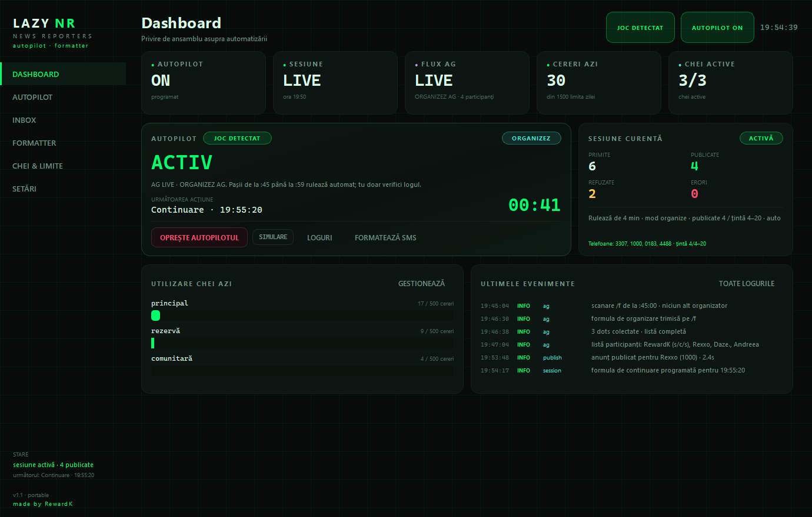
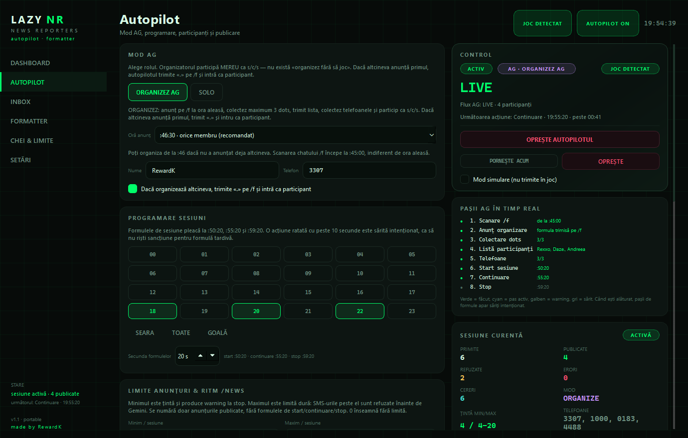
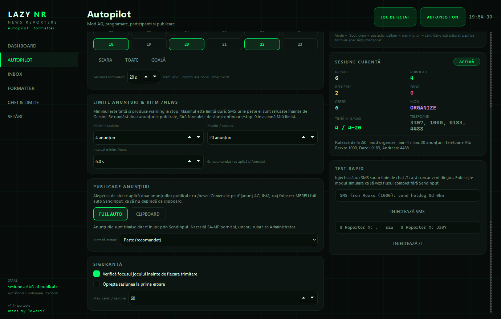
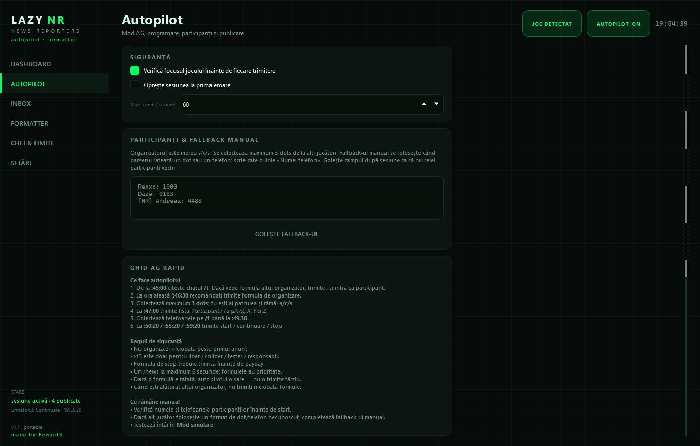
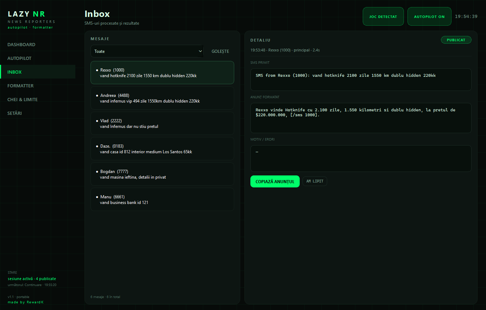
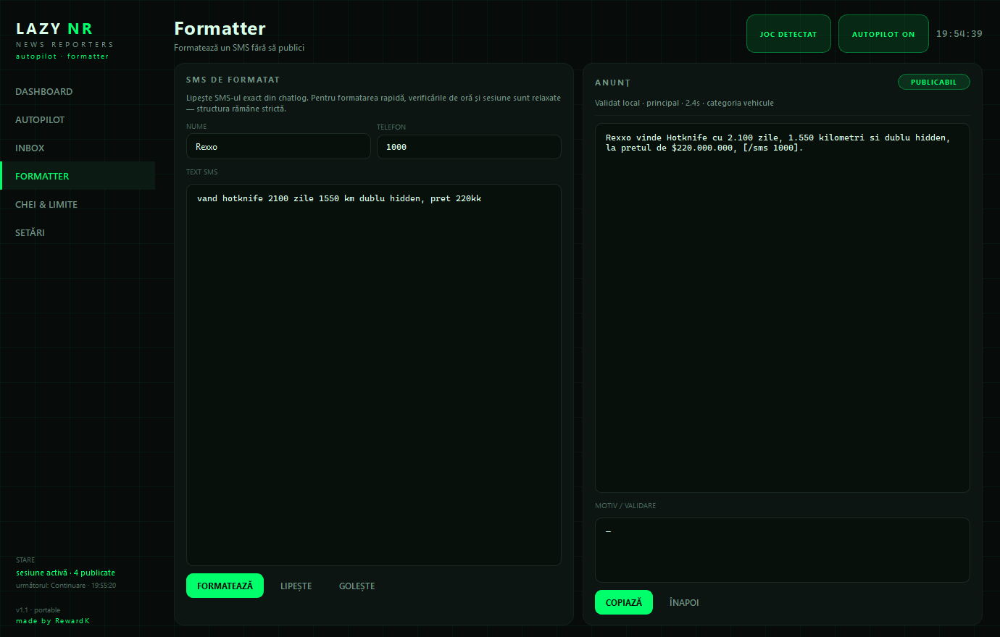
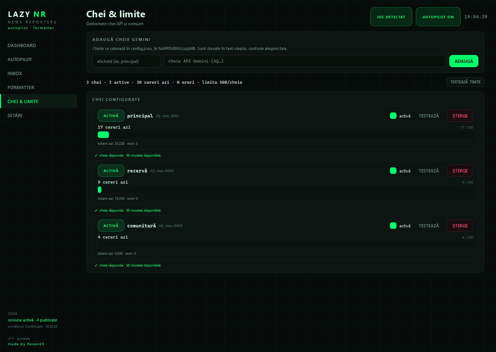

// readme facut 90% cu ai


<div align="center">
  
  <h1>Lazy NR <code>by RewardK</code></h1>
  <p><b>Autopilot AG pentru News Reporters.</b><br>
  <p>
    <a href="#download"></a>
    <a href="#cerinte"></a>
    <a href="#download"></a>
    <a href="https://www.virustotal.com/gui/file/12afb47e4b23fdab52c13df85bec3f2e527ccb4695f3c1b39d539719b9b0bb0f?nocache=1"></a>
    <a href="#credits"></a>
  </p>
  <p>
    <a href="../../releases/latest"><b>⬇️ download exe</b></a> ·
    <a href="#free-key"><b>🔑 cheie free gemini</b></a> ·
    <a href="#demo"><b>📸 screenshots</b></a> ·
    <a href="#faq"><b>❓ faq</b></a>
  </p>
</div>

---

## Ce este Lazy NR?

un soft care foloseste gemini prin api (ai 300 de requests gratis pe zi) pentru ca tu sa nu faci absolut nimic pentru aceasta factiune.

> [!IMPORTANT]
> **nu poti organiza fara sa participi**.

---

<a id="demo"></a>
## 📸 screenshots

| Dashboard live | Autopilot AG |
|:---:|:---:|
|  |  |

| Limite & publicare | Fallback manual & ghid |
|:---:|:---:|
|  |  |

| Inbox & validator | Formatter |
|:---:|:---:|
|  |  |

---

<a id="features"></a>
## ⚡ functii (scrise de AI, ca imi e lene)

| Funcție | Detaliu |
|---|---|
| **Autopilot AG complet** | Scanare `/f`, anunț, dots, listă, telefoane, start, continuare, stop. |
| **3 moduri** | `ORGANIZEZ AG` și `SOLO` selectabile; `ALĂTURAT` pornește automat când anunță alt organizator. |
| **Nu organizează peste altcineva** | Dacă alt organizator anunță primul, trimite `.` pe `/f` și intră ca participant. |
| **Organizator = s/c/s** | Participă mereu. Max **3** alți jucători, adică 4 telefoane în formulă. |
| **Formule la `:20`** | Start `:50:20`, continuare `:55:20`, stop `:59:20`; secunda este configurabilă. |
| **Fără formule târzii** | O acțiune ratată cu peste **10 secunde** este sărită intenționat. |
| **Alăturat = fără formule** | Nu trimite niciodată start/continuare/stop când organizează altcineva. |
| **Gemini + validator local** | Modelul formează, validatorul verifică structura, ora, telefonul, prețul și regulile AG. |
| **Min / max anunțuri** | Minimul avertizează la stop; maximul este limită dură înainte de Gemini. Formulele nu se numără. |
| **Ritm `/news`** | Maximum un `/news` la fiecare **6.0s** (configurabil), atât anunțuri cât și formule. |
| **Publicare full auto** | Aduce SA-MP în față, verifică focusul, lipește și apasă Enter. Alternativ, clipboard. |
| **`/f` mereu SendInput** | Comenzile de organizare nu depind niciodată de clipboard. |
| **Multi-cheie** | Rotește automat cheile, pune cheia în cooldown la `429` și încearcă următoarea. |
| **Inbox + Formatter** | Vezi fiecare SMS, anunțul final, motivul refuzului și validează manual. |
| **Mod simulare** | Parcurge tot fluxul AG fără să trimită nimic în joc. |
| **Portabil** | Un singur `.exe`. Datele stau în `%APPDATA%\LazyNR`. |

### De ce e util în practică

- **Nu ratezi fereastra de `:20`** — acțiunile sunt programate pe secundă, nu la `:00`.
- **Nu publici peste limită** — SMS-urile peste maxim sunt refuzate înainte de a consuma Gemini.
- **Nu trimiți formulă când ești alăturat** — exact greșeala care enervează organizatorul.
- **Nu rămâi cu dots necolectate** — parserul este tolerant, iar fallback-ul manual completează ce a scăpat.
- **Nu publici anunț invalid** — validatorul local este a doua poartă după model.

---

<a id="cerinte"></a>
## 🖥️ system reqs

- Windows **10 / 11** (64-bit).
- **SA-MP** pornit, cu fereastra jocului detectabilă.
- **Chatlog activ**: `Documents\GTA San Andreas User Files\SAMP\chatlog.txt`.
- **Internet** pentru Gemini.
- O cheie Gemini — poți folosi [cheia comunitară](#free-key) sau îți faci una proprie.
- Pentru SendInput: dacă SA-MP rulează ca Administrator, pornește și Lazy NR ca Administrator.

> Dacă `chatlog.txt` nu există, scrie `/chatlog` în SA-MP și verifică din nou folderul `SAMP`.

---

<a id="start"></a>
## 🚀 cum instalez ai u

1. **Descarcă** `Lazy NR by RewardK.exe` din [Releases](../../releases/latest) și rulează-l. Nu are installer.
2. Mergi la **Chei & limite** și adaugă [cheia comunitară](#free-key) sau o cheie a ta.
3. Mergi la **Autopilot**:
   - nume exact din joc;
   - telefon propriu;
   - rolul AG: `ORGANIZEZ AG` sau `SOLO` (`ALĂTURAT` pornește automat când anunță altcineva);
   - orele sesiunilor;
   - minimul / maximul de anunțuri.
4. Deschide SA-MP și asigură-te că chatlog-ul este activ.
5. Apasă **PORNEȘTE AUTOPILOTUL**. Prima dată folosește **Mod simulare** ca să vezi tot fluxul fără să trimiți nimic.
6. La `:45` începe scanarea. Tu doar verifici panoul „Pașii AG în timp real” și logul.

> [!TIP]
> Pentru prima sesiune, pune `:46:30` ca oră de anunț. Este recomandarea pentru orice membru și îți lasă timp să citești chatul.

---

<a id="download"></a>
## 📦 Descărcare & integritate

**Fișier:** `Lazy NR by RewardK.exe`  
**Versiune:** `1.1.0.0`  
**Mărime:** `49.374.803` bytes (≈ 47,1 MiB)  
**SHA-256:**

```text
12afb47e4b23fdab52c13df85bec3f2e527ccb4695f3c1b39d539719b9b0bb0f
```

**VirusTotal:** [raport pentru hash-ul de mai sus](https://www.virustotal.com/gui/file/12afb47e4b23fdab52c13df85bec3f2e527ccb4695f3c1b39d539719b9b0bb0f?nocache=1) — **1/69** (scan la 10.11.2026).

> [!WARNING]
> Raportul arată **1 detecție izolată din 69**. Pentru un `.exe` nesemnat, împachetat cu PyInstaller, este cel mai probabil un **false positive de heuristică**. Nu există garanție absolută pentru niciun binar: verifică hash-ul, uită-te la raport și rulează doar din sursa în care ai încredere.
>
> Windows SmartScreen poate cere confirmare la prima rulare: **More info → Run anyway**. Dacă antivirusul tău blochează fișierul, verifică hash-ul înainte de orice altceva.

---

<a id="free-key"></a>
## 🔑 cheie free de la mn #3 (gratuită)

Am lăsat una dintre chei liberă pentru comunitate, ca să poți testa aplicația fără să-ți faci cont Gemini în prima secundă.

> [!CAUTION]
> Cheia este **publică** (este publicată intenționat aici). Oricine o poate folosi, iar quota ei se poate termina sau poate fi revocată oricând. Pentru utilizare zilnică, stabilitate și confidențialitate, **fă-ți propria cheie** — vezi [tutorialul de mai jos](#own-key).

<details>
<summary><b>Arată cheia comunitară #3</b></summary>

```text
[redacted] nu ma lasa github s-o pun. daca vrei da-mi mesaj pe discord sau mai bine ia-ti tu una ca e gratis, ai tutorial mai jos facut de ai.
```

</details>

**Cum o folosești:**

1. Deschide **Chei & limite**.
2. La etichetă scrie `comunitară`.
3. Lipește cheia în câmpul de cheie.
4. Apasă **ADAUGĂ** — aplicația o testează automat.
5. Dacă apare o eroare `429`, `403` sau „cheie respinsă”, treci pe cheia ta.

> Cheia este pentru **Lazy NR**, nu pentru alte proiecte. Nu o copia în alte aplicații, nu o folosi pentru date personale și nu o revinde.

---

<a id="own-key"></a>
## 🛠️ Tutorial: cum îți pui propria cheie Gemini (facut de AI)

### 1. Ia o cheie din Google AI Studio

1. Intră pe [aistudio.google.com/app/apikey](https://aistudio.google.com/app/apikey).
2. Autentifică-te cu contul Google.
3. Apasă **Create API key** / **Get API key**.
4. Alege un proiect (sau creează unul nou).
5. Copiază cheia generată. Poate începe cu `AQ.` sau `AIza`.

### 2. Adaugă cheia în aplicație

1. Deschide **Chei & limite**.
2. Scrie o etichetă utilă: `principal`, `rezervă`, `acasă`.
3. Lipește cheia.
4. Apasă **ADAUGĂ**.
5. Aplicația o testează imediat. Dacă e validă, apare un mesaj verde.

### 3. Dacă vrei mai multă capacitate

- Poți adăuga **mai multe chei**. Aplicația le rotește automat.
- La `429`, cheia intră în cooldown și se încearcă următoarea.
- Poți dezactiva temporar o cheie din checkbox-ul **activă**, fără să o ștergi.
- Butonul **TESTEAZĂ TOATE** verifică toate cheile dintr-o singură acțiune.

### 4. Unde se salvează

Cheile sunt salvate în **text simplu** în:

```text
%APPDATA%\LazyNR\config.json
```

Nu urca `config.json` pe GitHub și nu îl trimite nimănui. Dacă vrei să resetezi tot, închide aplicația și șterge folderul `%APPDATA%\LazyNR`.



---

<a id="ag"></a>
## 🧠 Moduri AG & cronologie

### Roluri

| Rol | Ce face |
|---|---|
| **ORGANIZEZ AG** | Scanează `/f` de la `:45`, anunță la ora aleasă dacă nu organizează altcineva, colectează maximum **3** dots, trimite lista, colectează telefoanele și pornește sesiunea ca **s/c/s**. |
| **SOLO** | Nu anunță și nu colectează. Pornește doar cu telefonul propriu și publică anunțuri între `:50–:59`. |
| **ALĂTURAT** | Dacă alt organizator anunță primul, trimite `.` pe `/f`, intră ca participant și **nu trimite niciodată formulele de sesiune**. |

### Cronologie

| Ora | Acțiune |
|---|---|
| `:45:00` | Începe scanarea chatului `/f`, inclusiv mesajele dinainte de pornirea aplicației. |
| `:45:00` / `:45:30` | Opțiuni de anunț doar pentru **lider / colider / tester / responsabil**. Aplicația afișează un warning galben, dar opțiunile rămân selectabile. |
| `:46:00` / `:46:30` | Anunț pentru orice membru. **`:46:30` este recomandat** și este default-ul. |
| `:47:00` | Lista de participanți pe `/f`. |
| `:49:30` | Termen informativ pentru telefoane. |
| `:50:20` | Start sesiune + formula oficială. |
| `:55:20` | Continuare + formula oficială. |
| `:59:20` | Stop + formula oficială. |

### Reguli respectate automat

- **Nu organizezi peste primul anunț.** Dacă altcineva a anunțat între `:45` și ora ta, aplicația trimite `.` și se alătură.
- **Organizatorul este mereu s/c/s.** Nu există „organizez fără să joc”.
- **Maximum 3 alți participanți.** Tu + 3 = 4 telefoane în formulă.
- **Lista este trimisă la `:47`**, nu la `:50`.
- **Formulele sunt oficiale**, nu texte scrise de model.
- **O formulă întârziată este mai riscantă decât una lipsă.** După fereastra de 10 secunde, acțiunea este sărită.
- **Când ești alăturat, nu trimiți formule.** Publici doar anunțuri.

### De ce `:20`?

Pentru că ceasul din joc se actualizează cu întârziere față de cel al PC-ului. Trimiterea la `:50:20` reduce riscul ca formula să apară la `:49:59` sau să fie considerată târzie. Secunda este configurabilă, dar **20** este alegerea sigură.

---

<a id="limits"></a>
## 📊 Limite de anunțuri & ritm `/news`

| Setare | Comportament |
|---|---|
| **Minim / sesiune** | Țintă. Dacă nu este atinsă, la stop apare un warning. Nu blochează publicarea. |
| **Maxim / sesiune** | Limită dură. SMS-urile peste ea sunt refuzate **înainte** de Gemini. `0` = fără limită. |
| **Interval minim `/news`** | Implicit `6.0s`. Se aplică anunțurilor și formulelor. Fiecare formulă are fereastră de 10 secunde; dacă throttle-ul ar face-o prea târzie, este sărită. |

- Se numără **doar anunțurile publicate**. Formulele de start / continuare / stop sunt excluse.
- Dacă o formulă ar trebui să aștepte peste fereastra de 10 secunde din cauza throttle-ului, este sărită.
- Minimul este o țintă, nu o garanție: dacă nu ai SMS-uri, nu are ce publica.

---

<a id="publish"></a>
## 📤 Publicare

| Mod | Cum funcționează |
|---|---|
| **FULL AUTO** | Aduce SA-MP în prim-plan, verifică focusul, lipește textul cu `Ctrl+V` (sau tastează caracter cu caracter) și apasă `Enter`. Recomandat. |
| **CLIPBOARD** | Copiază anunțul și așteaptă confirmarea „Am lipit” din Inbox. Pentru formule, trebuie să lipești imediat — aplicația avertizează. |

- Alegerea de publicare se aplică **doar anunțurilor** trimise cu `/news`.
- Comenzile pe `/f` (anunț AG, listă, `.`) folosesc **mereu full auto SendInput**, indiferent de modul de publicare.
- Dacă SA-MP rulează ca Administrator, pornește și Lazy NR ca Administrator. Altfel Windows blochează SendInput.

---

<a id="pages"></a>
## 🧭 Paginile aplicației

### Dashboard
Vezi dintr-o privire dacă autopilotul este pornit, ce sesiune rulează, în ce pas este AG-ul, câte cereri ai făcut azi și ultimele evenimente.

### Autopilot
Aici configurezi tot fluxul:
- rolul AG;
- ora anunțului;
- numele și telefonul;
- orele de sesiune;
- secunda formulelor;
- limitele de anunțuri;
- modul de publicare;
- fallback-ul manual.

### Inbox
Fiecare SMS are un rând: textul primit, anunțul formatat, statusul, cheia folosită, durata și motivul refuzului. Poți copia anunțul sau confirma lipirea în modul clipboard.

### Formatter
Lipești un SMS complet (`SMS from Nume (1234): text`) sau completezi nume + telefon + text. Aplicația formatează cu Gemini și validează local. Verificările de oră și sesiune sunt relaxate, dar structura anunțului rămâne strictă.

### Chei & limite
Adaugi, testezi, activezi/dezactivezi sau ștergi chei. Vezi consumul pe fiecare cheie și erorile recente.

### Setări
Model, limite, fișiere, loguri și alte opțiuni tehnice.

### Loguri
Butonul **LOGURI** deschide un CMD separat, cu titlul `Lazy NR - LOGS`. Poți porni și direct:

```powershell
"Lazy NR by RewardK.exe" --console-log
```

<details>
<summary><b>Comenzi disponibile în fereastra de loguri</b></summary>

```text
/all /info /warn /err /debug /cat gemini /grep text /since HH:MM
/pause /follow /clear /help /close
```

</details>

---

<a id="fallback"></a>
## 🧩 Fallback manual pentru participanți

Parserul citește tolerant chatul `/f`: dots, liste de participanți și telefoane în formate uzuale. Când un jucător folosește un format necunoscut sau un mesaj este ratat, completează manual în **Autopilot → Participanți & fallback manual**, câte o linie:

```text
Rexxo: 1000
Daze - 0183
[NR] Andreea
# comentariu ignorat
```

- Fallback-ul completează **dots și telefoanele lipsă**.
- Nu suprascrie ce a fost deja colectat automat.
- Golește câmpul după fiecare sesiune, ca să nu reiei participanți vechi.

---

<a id="data"></a>
## 🔒 Date & confidențialitate

Toate datele stau în `%APPDATA%\LazyNR`:

| Fișier | Conținut |
|---|---|
| `config.json` | model, ore, identitate, rol AG, limite, chei API (text simplu) |
| `usage.json` | consum pe cheie și pe zi (ultimele 30 de zile) |
| `inbox.json` | SMS-uri procesate și rezultate |
| `logs\lazy-YYYY-MM-DD.log` | log text pentru fereastra CMD |
| `logs\events-YYYY-MM-DD.jsonl` | evenimente structurate |

- Exe-ul este portabil, dar datele rămân pe PC.
- Poți muta folderul de date cu variabila `LAZYNR_DATA` (util pentru teste).
- Aplicația nu are server propriu și nu trimite telemetrie.
- Textul SMS-urilor și contextul necesar sunt trimise la **Gemini** pentru formatare. Cheile sunt folosite doar pentru API-ul Gemini.
- `config.json` conține cheile în clar. Nu îl distribui.

---

<a id="faq"></a>
## ❓ faq

<details>
<summary><b>Pot folosi aplicația fără cheie Gemini?</b></summary>

Nu. Formatarea și decizia PUBLISH/REFUSE trec prin Gemini. Poți folosi cheia comunitară sau îți faci una proprie.
</details>

<details>
<summary><b>Pot organiza dacă nu sunt lider / colider / tester / responsabil?</b></summary>

Da. Alege `:46:00` sau `:46:30`. Opțiunile de `:45` există, dar sunt pentru rangurile care au voie să deschidă AG-ul atât de devreme; aplicația afișează un warning galben.
</details>

<details>
<summary><b>Pot organiza fără să particip?</b></summary>

Nu. Organizatorul este mereu s/c/s și este primul telefon din formulă. Regula este intenționată.
</details>

<details>
<summary><b>Pot colecta mai mult de 3 dots?</b></summary>

Nu. Maximum 3 alți participanți. Al patrulea dot este ignorat.
</details>

<details>
<summary><b>De ce nu trimite formule când sunt alăturat?</b></summary>

Pentru că organizatorul este altcineva. Aplicația publică anunțuri între `:50–:59`, dar nu trimite start / continuare / stop peste el.
</details>

<details>
<summary><b>Ce se întâmplă dacă un alt organizator apare după ora mea?</b></summary>

Ideal este să nu se întâmple: ai anunțat primul. Dacă apare în timpul scanării, aplicația se alătură. Dacă apare după ce ai trimis anunțul, discută în joc și respectă regulile AG — aplicația nu poate negocia.
</details>

<details>
<summary><b>De ce s-a sărit o formulă?</b></summary>

Fereastra de 10 secunde a expirat. O formulă trimisă prea târziu poate fi sancționată, așa că aplicația o marchează ca sărită. Verifică logul și ceasul PC-ului.
</details>

<details>
<summary><b>Cheia comunitară nu mai merge. Ce fac?</b></summary>

Probabil quota s-a terminat sau cheia a fost revocată. Folosește [tutorialul pentru cheia proprie](#own-key). Cheia publică este un bonus, nu o garanție.
</details>

<details>
<summary><b>Datele mele ajung pe un server?</b></summary>

Nu există server Lazy NR. Doar cererile către Gemini pleacă în internet. Logurile și configul rămân local.
</details>

---

<a id="troubleshooting"></a>
## 🧯 Troubleshooting

| Problemă | Verifică |
|---|---|
| **JOC OPRIT** deși SA-MP este deschis | Rulează ambele cu aceleași drepturi (Administrator sau normal). Verifică numele ferestrei și procesul `gta_sa.exe`. Restartează aplicația după ce intri în joc. |
| **Nu vine niciun SMS** | Chatlog-ul este activ? Există `Documents\GTA San Andreas User Files\SAMP\chatlog.txt`? Scrie `/chatlog` în joc. |
| **`429` / `403` / cheie respinsă** | Quota s-a terminat sau cheia este invalidă. Testează cheia, adaugă una nouă sau folosește alta. |
| **Formulele sunt sărite** | Ceasul PC-ului este sincronizat? Ai pornit autopilotul prea târziu? Fereastra este de 10 secunde. |
| **Nu apasă Enter / nu lipește** | SA-MP rulează ca Administrator? Pornește Lazy NR la fel. Folosește **FULL AUTO** și verifică focusul. |
| **SmartScreen / antivirus** | `More info → Run anyway` după ce ai verificat hash-ul și raportul VirusTotal. |
| **Fallback-ul nu completează** | Folosește formatul `Nume: telefon`, câte o linie. Golește câmpul după sesiune. |
| **Alt organizator a apărut primul** | Aplicația trimite `.` și se alătură. Nu forța organizarea peste el. |

---

<a id="build"></a>
## 🧑‍💻 Build din sursă

```powershell
# clonează repo-ul, apoi intră în folder
cd lazy-nr
python -m pip install -r requirements.txt

python app.py                 # GUI
python app.py --selftest      # test rapid, fără afișare
python -m unittest discover -s tests -v
```

Build `.exe`:

```powershell
python -m PyInstaller --onefile --windowed --clean --noconfirm `
  --name "Lazy NR by RewardK" --icon assets/icon.ico `
  --add-data "assets;assets" --version-file build/version_info.txt `
  app.py
```

Rezultatul apare în `dist\Lazy NR by RewardK.exe`.

---

<a id="credits"></a>
## ❤️ Credits & disclaimer

**Făcut de RewardK** pentru toti smecherii

- Regulile AG ale comunității au prioritate față de orice automatizare.

<p align="center"><b>Lazy NR by RewardK · v1.1.0.0</b><br><code>made by RewardK</code></p>
